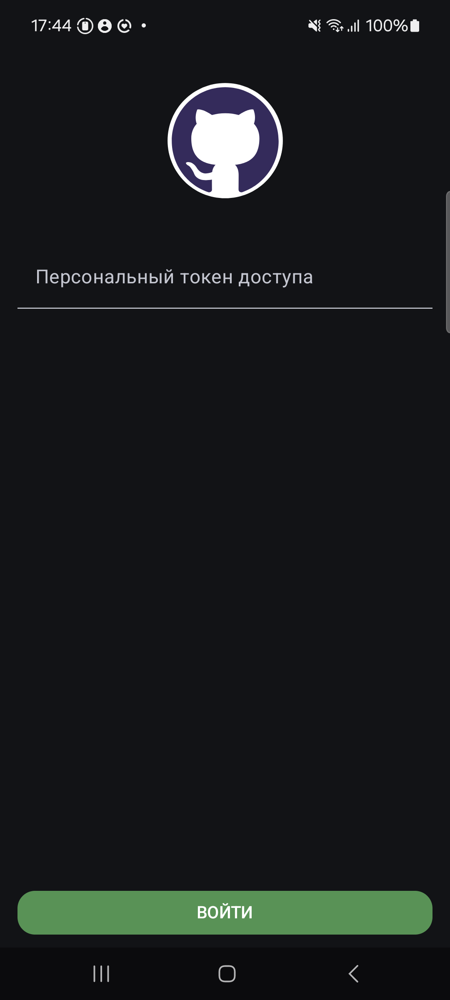
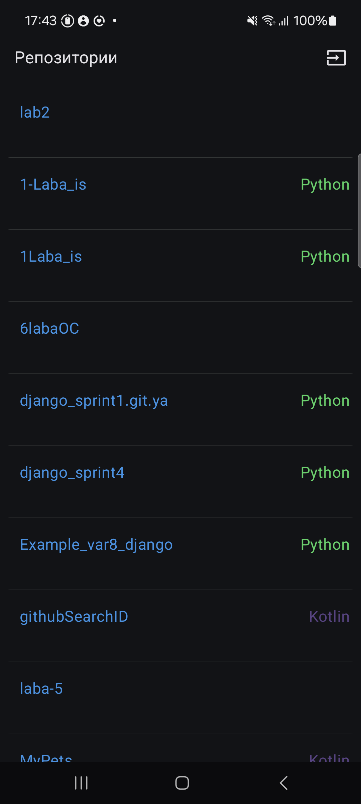
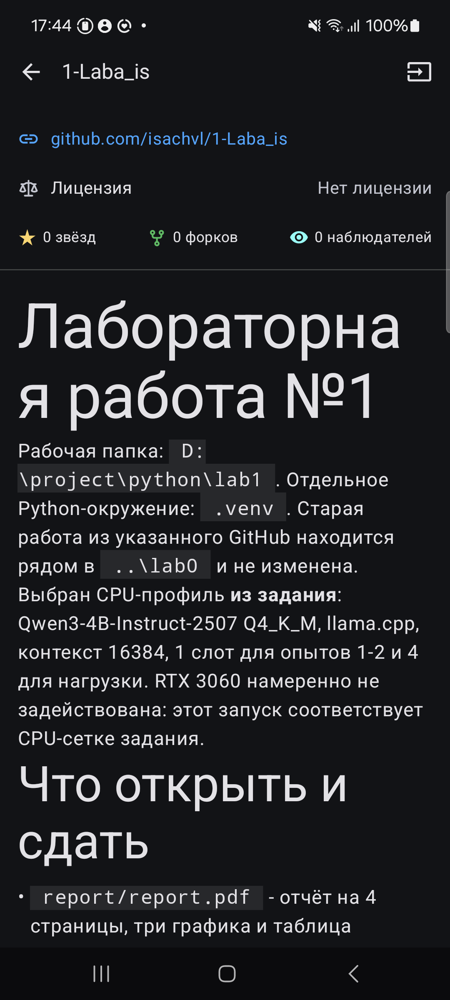

# GitHubSearch

Android-приложение для работы с GitHub REST API. Позволяет авторизоваться через персональный токен доступа (PAT), просматривать свои репозитории и информацию о них.

## Функциональность

- Авторизация через GitHub PAT.
- Сохранение токена между запусками приложения.
- Просмотр списка репозиториев с описанием и языком программирования.
- Просмотр лицензии, звёзд, форков и наблюдателей.
- Отображение README.md с Markdown-разметкой.
- Обработка ошибок сети и загрузки данных.
- Выход из аккаунта.

## Технологии

| | |
|---|---|
| Язык | Kotlin 2.2.10 |
| Min SDK | API 26 (Android 8.0) |
| Target SDK | API 37 |
| Compile SDK | API 37 |
| Архитектура | MVVM |
| UI | Jetpack Compose, Material 3 |
| HTTP | Ktor Client 3.6.0 |
| Сериализация | Kotlinx Serialization |
| DI | Koin 4.2.2 |
| Асинхронность | Kotlin Coroutines |
| Состояния | StateFlow |
| Навигация | Navigation Compose |
| Хранение токена | SharedPreferences |
| Markdown | Multiplatform Markdown Renderer |
| Анимации | Lottie |

## Локализация

Поддерживаются русский и английский языки.

## Тестирование

Приложение проверено на **Samsung Galaxy A52**. Поддерживается смена ориентации экрана (вертикальная и горизонтальная).

## Скриншоты

## Скриншоты

  
  
  

